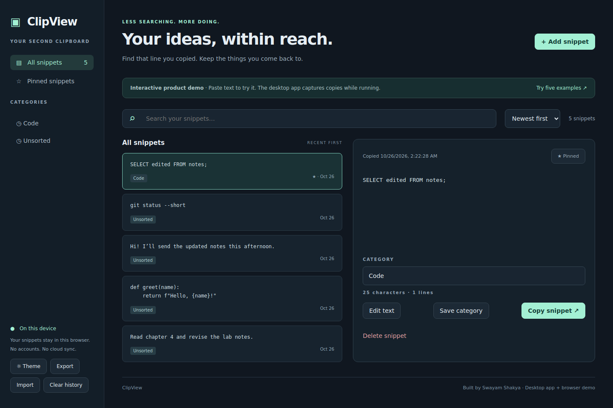
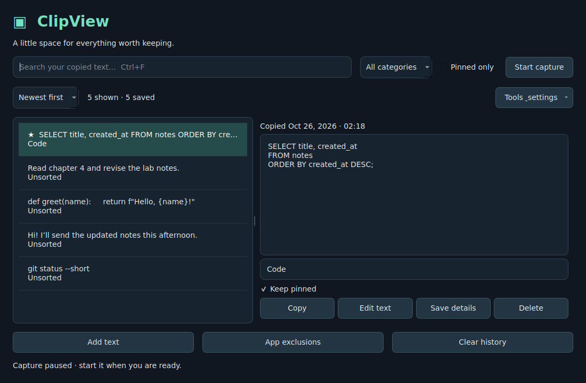
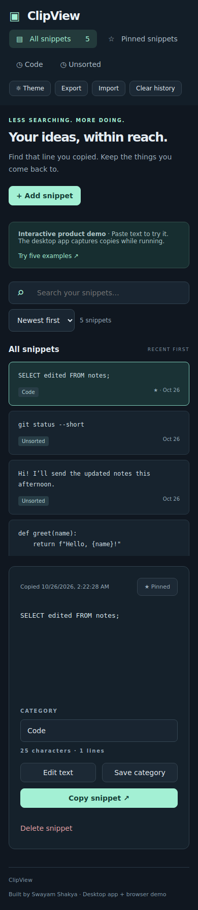

# [ClipView](https://requiemdoomed.github.io/ClickView/)

ClipView keeps useful text close: code fragments, class notes, messages, and the little things you would otherwise have to recreate. The Python desktop app saves clipboard changes while running. The responsive browser demo lets you try the same workflow with explicitly pasted text.



<details>
<summary>Native desktop app and mobile demo</summary>





</details>

## What you can do

- Capture text, search its full contents, and copy it back without changing whitespace.
- Pin favorites and assign your own categories.
- Keep history across restarts; repeated copies update the existing item.
- Pause capture, exclude applications, delete individual snippets, or clear history.
- Edit saved text without losing its pin, category, or original copy date.
- Export and import versioned JSON backups between the desktop and browser versions.
- Choose light or dark mode, sort oldest/newest first, and keep pins when clearing history.
- Configure automatic age cleanup and skip several common secret formats on desktop.
- Use SQLite immediately or connect to a local MySQL database.
- Try the responsive HTML/CSS/JavaScript demo on desktop or mobile.

## Run the desktop app

Python 3.10+ is required. Python 3.12 is the CI target. From this repository folder:

```bash
python -m venv .venv
```

Activate it on **Windows PowerShell**:

```powershell
.venv\Scripts\Activate.ps1
```

Or on **macOS / Linux**:

```bash
source .venv/bin/activate
```

Then:

```bash
python -m pip install -e ".[test]"
python -m clipview
```

Click **Start capture**, switch to another app, and copy some text. Search, select a result, and click **Copy** to restore it. **Ctrl+F** (Command+F on macOS) focuses search; **Ctrl+N** opens Add text. Closing the window quits capture; there is no hidden background service or automatic startup.

**Linux X11:** install `xdotool` using your distribution's package manager for app detection. **Wayland:** automatic capture is deliberately blocked because this implementation cannot identify the foreground app reliably; use **Add text**. **macOS:** foreground detection uses System Events and may need Automation permission. Qt may report external clipboard changes only when ClipView becomes active; return to the app after copying. Windows foreground detection uses the process name. Native Windows/macOS behavior still needs the manual checks in [TESTING.md](docs/TESTING.md).

## Privacy and limits

- Capture starts paused on every launch and ignores the clipboard contents already present at startup.
- Exclusions match app-name fragments, ignoring case. Bitwarden, 1Password, KeePass, and LastPass are excluded initially. You can add more in **App exclusions**.
- Unknown foreground applications are skipped. The foreground app is a best-effort signal, not proof of which process wrote the clipboard. Background changes, browser password managers, and rapid focus changes can evade app exclusions. Pause before copying secrets. Individual browser tabs and password fields cannot be recognized.
- SQLite lives under Qt's application-local data directory (`ClipView/history.sqlite3`). The desktop clear dialog preserves pins unless selected otherwise and also clears the current system clipboard. Logical deletion is not a promise of secure erasure from disk, database logs, or backups.
- The web demo uses this browser's localStorage, with a 2,000-snippet cap and the browser's storage quota. It is separate from desktop history. Clearing it does not erase the system clipboard. Failed history writes are rolled back and shown in a persistent warning; theme changes may last only for the current session if preferences cannot be saved.
- The mobile experience is a responsive browser demo, not a native Android/iOS clipboard monitor. Browsers cannot silently monitor your other apps.

Implementation references: [Qt clipboard](https://doc.qt.io/qtforpython-6/PySide6/QtGui/QClipboard.html), [Python sqlite3](https://docs.python.org/3/library/sqlite3.html), and [PyMySQL](https://pymysql.readthedocs.io/en/latest/).

## License

[MIT](LICENSE) · Copyright © 2026 Swayam Shakya. Third-party dependencies retain their own licenses.
